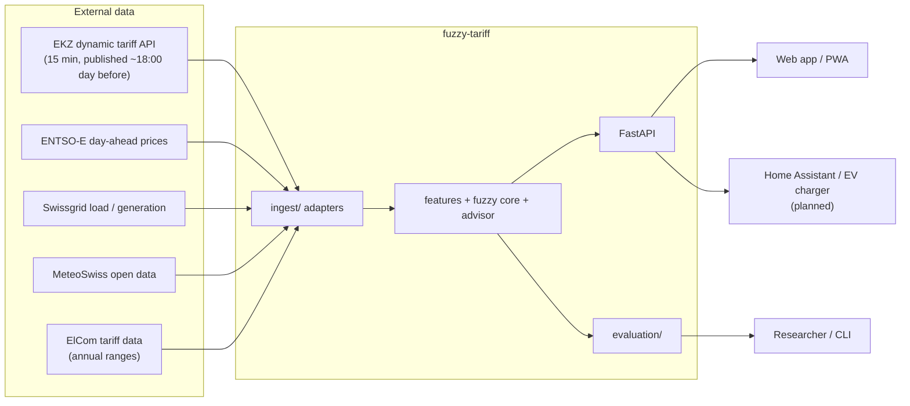
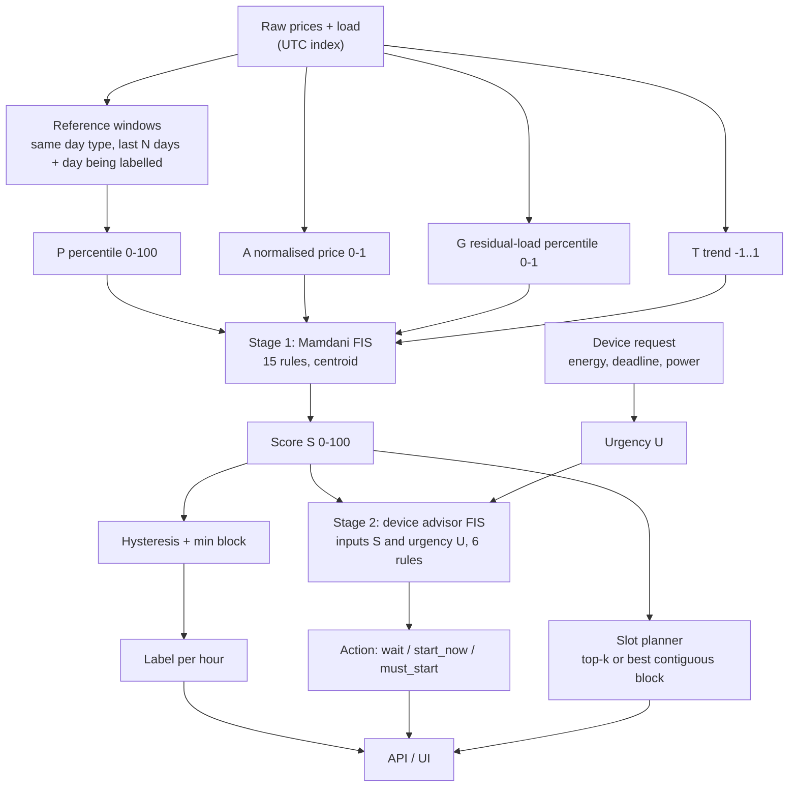

# Architecture

Status: v0.1, matches the code in `src/fuzzy_tariff/` as of 2026-10-18.
Requirements: see `prd.md`. Decisions: see `docs/adr/`.

## 1. Purpose

A small, explainable fuzzy decision service. Input: tariff prices (and optionally grid load) for upcoming hours. Output: a plain-language label per hour and device-specific advice, each with the rules that produced it.

## 2. Principles

1. **Pure core, impure edges.** Fuzzy logic, features and evaluation are pure functions over NumPy/pandas. All network and file formats live in `ingest/`.
2. **Behaviour is data.** Membership functions and rules are YAML, validated at load time. Code does not contain magic numbers about "cheap".
3. **Explainable by construction.** Every inference returns fired rules with strengths.
4. **Deterministic.** No hidden randomness. Synthetic data and perturbations take explicit seeds.
5. **Ports and adapters.** Core depends on `PriceSource`/`LoadSource` protocols, never on a vendor API.
6. **Fail loudly on bad config, degrade gracefully on odd data** (flat tariffs, gaps, DST).

## 3. System context



## 4. Package map and dependency rules

```
src/fuzzy_tariff/
  fuzzy/        membership, variables, rules, engine (Mamdani), config (YAML -> engine), default.yaml
  features/     reference windows -> P, A, G, T
  stability.py  hysteresis on memberships, minimum block length
  labeler.py    features -> score -> stable label (stage 1 service)
  advisor/      device profiles, urgency, stage-2 FIS, slot planner
  labels.py     enums + DE/FR/IT/EN strings
  evaluation/   baselines, metrics, sensitivity/ablation, backtest runner
  synthetic.py  toy hourly scenarios (smoke tests, edge cases such as flat tariffs)
  tariff_sim.py EKZ-style 15-minute dynamic tariff simulator (energy + grid + total); accepts real spot and load
  ingest/       ports + adapters (ENTSO-E, EKZ skeleton, CSV loader). Only place with network/file formats
  api/          FastAPI app and schemas
  services.py   builds engines once (lru_cache)
  settings.py   environment variables
  cli.py viz.py entry points
```

| Package | May import | Must not import |
|---|---|---|
| `fuzzy` | numpy, pydantic, yaml | pandas, httpx, fastapi, anything else in the project |
| `features` | pandas, numpy | `fuzzy`, `api`, `ingest` |
| `stability`, `labeler` | `fuzzy`, `features` | `api`, `ingest` |
| `advisor` | `fuzzy`, `labels` | `api`, `ingest`, pandas |
| `tariff_sim` | `features` (time helpers), pandas, numpy | `fuzzy`, `api`, `ingest` |
| `evaluation` | everything in core | `api`, `ingest` |
| `ingest` | httpx, pandas | `fuzzy`, `evaluation`, `api` |
| `api` | `services`, `advisor`, `labels` | `ingest`, `evaluation` |

Keeping `fuzzy/` free of pandas and web code is what makes it reusable in a course report, a notebook or an embedded device.

## 5. Data flow



## 6. The fuzzy design (summary)

Full parameters: `src/fuzzy_tariff/fuzzy/default.yaml`.

**Stage 1 inputs:** P (very_low..very_high), A (low/medium/high), G (low/medium/high), T (falling/stable/rising).
**Stage 1 output:** S in 0-100 with sets avoid, wait, okay, good, ideal.
**Inference:** min for AND, min implication, max aggregation, centroid defuzzification on a 1001-point grid.
**Label:** set with the highest membership at S, with hysteresis margin 0.1 and minimum block of 2 steps.

**Stage 2:** inputs S and urgency U = (energy / power) / hours until deadline, clipped to 0-1. Output Action with sets wait, start_now, must_start. Deadlines override price (rule D06).

**Guardrails built in**
- Rule R03 prevents "cheap" labels when the absolute price is high.
- Flat tariffs: if the window's interquartile range is below 0.005 CHF/kWh, P is set to 50; A is set to 0.5 when the annual range is below 0.02 CHF/kWh; T's scale is floored. A flat tariff therefore produces a calm "normal".
- Rule base completeness is tested on a dense grid.

**Why two stages:** keeps each rule base small and readable (15 + 6 instead of a combinatorial single table). See ADR-0003.

## 7. Feature engineering

Time-based parameters (minimum block, trend horizon) are defined in **hours** and converted to steps from the spacing of the index, so the same pipeline runs on hourly and 15-minute (EKZ) data.

- Timestamps are tz-aware; all calendars use `Europe/Zurich`, storage uses UTC. Windows are defined on local calendar days so DST changes do not drop or duplicate hours (tested: 8760 rows for 2025).
- Reference window for P: previous `window_days` (default 30) local days of the same day type (weekday/weekend) plus the day being labelled. Including the labelled day is not leakage because day-ahead tariffs are published before the day begins.
- Percentile uses mid-rank for ties.
- Grid stress G is the percentile of residual load (load minus solar) in the same kind of window, scaled to 0-1; defaults to 0.5 if no load data.

## 8. API contract

| Method + path | Purpose | Notes |
|---|---|---|
| `GET /healthz` | liveness | returns version |
| `POST /v1/score` | crisp (P, A, G, T) to score, label, translated text, memberships, fired rules | 422 on out-of-range; 500 if a rule-base gap is ever hit |
| `POST /v1/advice` | suitability + device request to action | urgency computed server-side |
| `POST /v1/plan` | list of per-slot scores + device to chosen slot indices | contiguous for appliances; 422 if deadline too short |
| `GET /v1/config` | active fuzzy configuration | for UI plotting and audits |

Schemas: `src/fuzzy_tariff/api/schemas.py`. The API is versioned (`/v1`); breaking changes require `/v2`.

Not yet implemented: an endpoint that takes raw tariff series and returns labels for a day (planned; the library path `build_features -> FuzzyLabeler.label` already does this).

## 9. Configuration management

- `default.yaml` is packaged and loaded via `load_config()`; `FUZZY_TARIFF_CONFIG` overrides it.
- pydantic validates shapes, parameter ordering, rule references, duplicate IDs, defaults for unknown inputs.
- Any change to the YAML is a behaviour change: update tests, PRD appendix and, if rationale changes, an ADR.

## 10. Evaluation architecture

`evaluation/backtest.py` runs three labellers over the same series: fixed CHF thresholds, crisp percentile bands, fuzzy. Metrics (`metrics.py`): label flips per day, isolated cheap-window rate, label distribution by season, overnight EV-charging cost vs naive and vs oracle. `sensitivity.py`: shift all input sets by up to ±x% of universe width and measure label agreement; replace one input by a neutral value and measure the change.

Known limitation: the EV-cost metric ranks hours; methods that rank by price alone already reach the oracle on smooth data, so it cannot separate them. It becomes informative once guidance uses G and T on real data, and is complemented by stability and user-study metrics.

## 11. Data architecture

```
data/raw/        immutable downloads, never edited, git-ignored
data/processed/  cleaned hourly tables, reproducible from raw by scripts
data/synthetic/  generated scenarios (seeded), git-ignored
reports/         generated outputs (backtests, figures), git-ignored
```

Raw API responses are stored unmodified; parsing happens in `ingest/`. The EKZ tariff logger (`scripts/log_ekz_tariff.py`, to implement) builds our own real dynamic-tariff history from now on. Source notes: `docs/data-sources.md`.

### Dynamic tariff simulator
`tariff_sim.py` generates EKZ-style tariffs (see `docs/dynamic-tariff-model.md`, ADR-0007). It takes a spot-price series and a net-load series (real or synthetic) and returns energy, grid and total tariffs in Rp./kWh per 15-minute step. `to_pipeline_frame` selects the component and converts to CHF/kWh for the fuzzy pipeline.

## 12. Deployment

Single stateless container (`Dockerfile`: multi-stage, non-root user, healthcheck, uvicorn). Config is baked in or mounted via env. Horizontal scaling is trivial because state is read-only after startup. A static front end can be served separately or by the same host.

## 13. Observability

- Structured explanation in every response (fired rules) is the primary debugging tool.
- Standard `logging` with `LOG_LEVEL`.
- Planned: request metrics and a label-distribution drift check in production (alert if one label dominates a season).

## 14. Security and privacy

- No personal data in MVP. Pilot data (if any) only with consent, minimised, stored per Swiss FADP.
- Secrets (ENTSO-E token) only via environment; `.env` is git-ignored; pre-commit hook detects private keys.
- Strict input validation (pydantic ranges, list length caps) on all endpoints.
- Rate limiting and TLS belong to the deployment gateway.

## 15. Testing strategy

| Layer | What | Where |
|---|---|---|
| Unit | membership functions (incl. property-based with Hypothesis), rules, config validation | `tests/test_membership.py`, `test_config.py` |
| Golden | worked example from docs must reproduce S ≈ 86.7 | `test_engine.py` |
| Property/behaviour | monotonicity in P, guardrail, completeness, batch equals single | `test_engine.py` |
| Integration | features to labeler to backtest; API via TestClient | `test_features.py`, `test_evaluation.py`, `test_api.py` |
| Edge cases | flat tariff, DST, NaN, missing inputs, ENTSO-E gaps | various |
| Quality gates | ruff, mypy, coverage at least 85% | CI |

## 16. Quality attributes

| Attribute | How the design supports it |
|---|---|
| Explainability | fired rules in every response, YAML rules, ADRs |
| Stability | hysteresis + min block + guards for flat data |
| Testability | pure functions, injectable HTTP client, seeded generators |
| Modifiability | config-driven sets and rules, ports for data |
| Performance | vectorised inference, chunked aggregation (4096 rows) |
| Reproducibility | seeds, pinned config, deterministic evaluation |

## 17. Decision records

| ADR | Decision |
|---|---|
| 0001 | Mamdani FIS as the primary engine; Sugeno as a comparison |
| 0002 | Membership functions and rules live in validated YAML |
| 0003 | Two-stage (hierarchical) FIS |
| 0004 | Own NumPy engine instead of scikit-fuzzy |
| 0005 | Relative percentile context plus absolute guardrail and flat-data guards |
| 0006 | Stability layer: hysteresis on memberships plus minimum block length |
| 0007 | EKZ-style dynamic tariff simulator instead of toy price curves |

## 18. Extension points

| Want to... | Do this |
|---|---|
| Add or change a rule | Edit `default.yaml`; run `make check`; update PRD appendix |
| Add an input variable | Add to `inputs` in YAML, compute in `features/`, extend `ScoreRequest`, tests, ADR if semantic |
| Add a device | Add to `Device` and `DEVICE_PROFILES`, extend messages, tests |
| Add a data source | New adapter in `ingest/` implementing the port; fixture test; note in `docs/data-sources.md` |
| Add a Sugeno engine | Implement beside `engine.py` with the same `infer/infer_many` interface; compare in backtest |
| Tune membership functions | New module `tuning/` (GA/PSO) that outputs a YAML file; never mutate code |
| Interval type-2 sets | New engine class; keep type-1 as baseline |

## 19. Known limitations and tech debt

- Membership parameters are uncalibrated starting values.
- EKZ adapter and logger are skeletons; schema must be read from EKZ's API documentation first.
- ENTSO-E adapter tested on a fixture only, not against the live API; verify the CH domain.
- `MeteoSwiss` and `Swissgrid` have only the generic CSV loader; column layouts are not hard-coded on purpose.
- No UI yet; no endpoint for raw series to labels.
- Translations are drafts.
- Simulated tariffs are not evidence about real households; standard tariff levels and the standard load profile in the simulator are illustrative.
- The simulator uses a heuristic instead of EKZ's mixed-integer optimisation.

## 20. Roadmap

1. Run the EKZ logger daily; pull ENTSO-E history.
2. Calibrate sets on data; expert rule review; sensitivity report.
3. Raw-series endpoint and PWA timeline.
4. Usability tests and pilot.
5. Stretch: GA/PSO tuning, Sugeno comparison, interval type-2.
