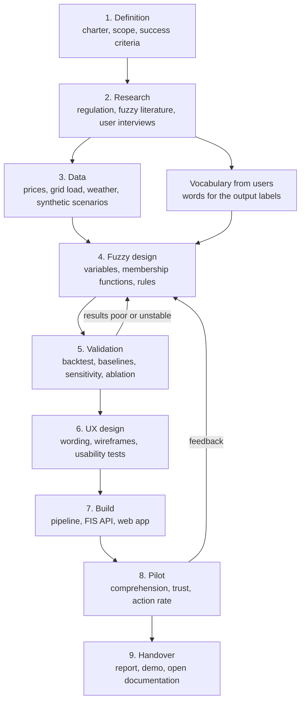
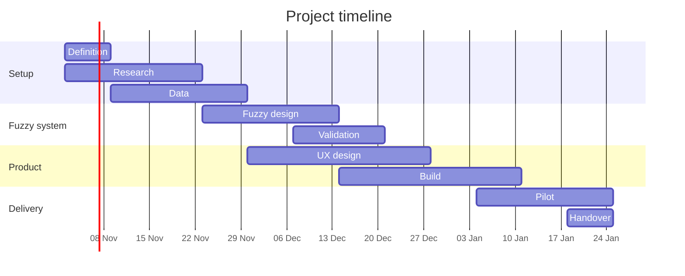
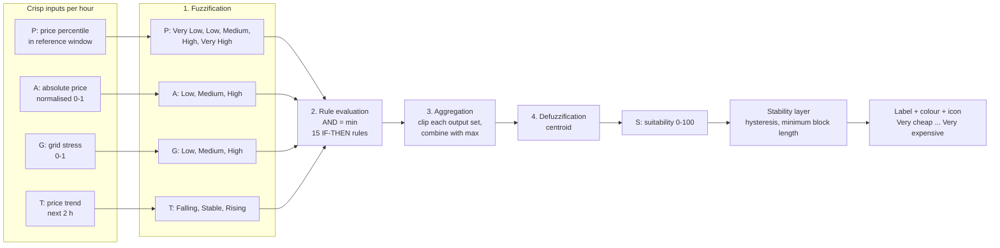
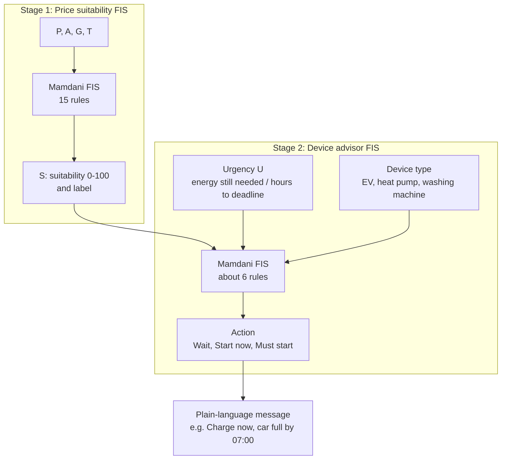
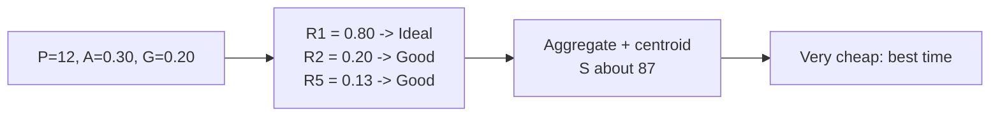
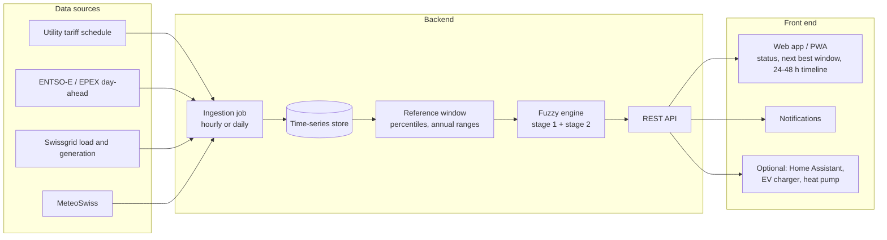
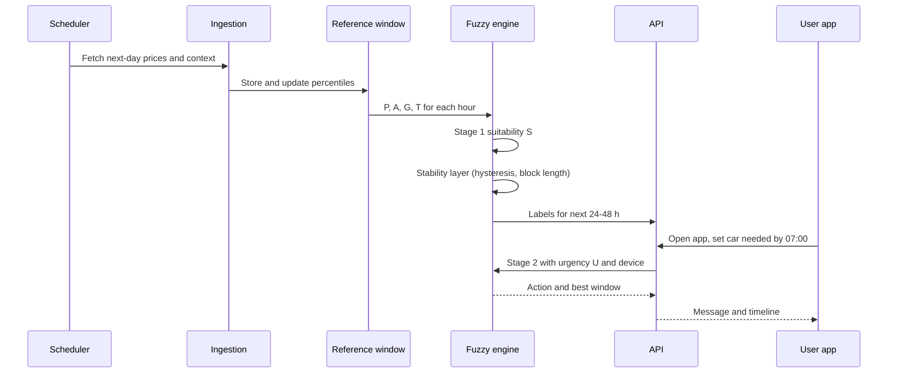
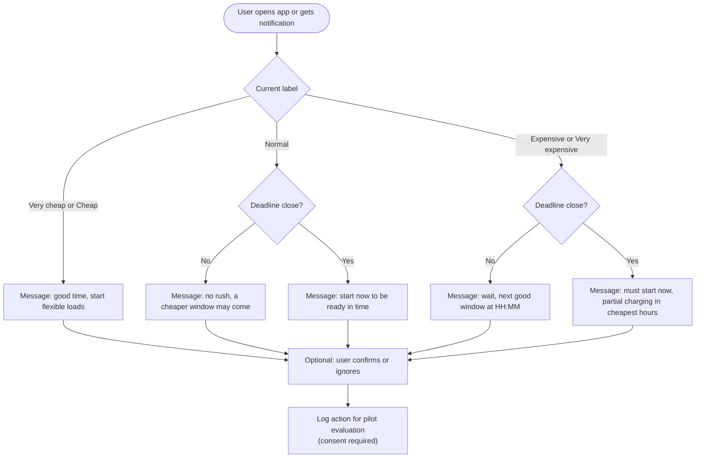
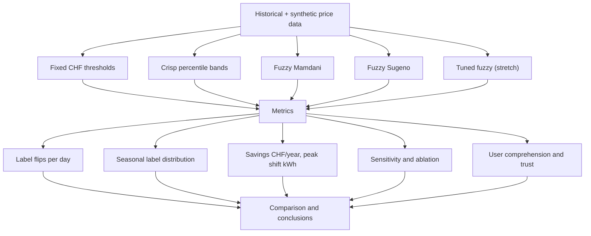

# Flow: Fuzzy Guidance for Dynamic Electricity Tariffs

This file shows how the project and the fuzzy system fit together. Diagrams use Mermaid and render on GitHub, VS Code (with a Mermaid extension) and most Markdown viewers.

Contents:
1. Project workflow end to end
2. Timeline
3. Fuzzy inference pipeline
4. Two-stage structure (price label, then device advisor)
5. Worked example
6. System architecture and runtime sequence
7. User decision flow

---

## 1. Project workflow end to end

---

## 2. Timeline (12 weeks, example start 2 Nov 2026)

Adjust dates for holidays and your actual deadline.

---

## 3. Fuzzy inference pipeline (Mamdani)

### Membership functions (starting values, to be calibrated on data)

| Variable | Set | Shape | Parameters |
|---|---|---|---|
| P (0-100) | Very Low | trapezoid | 0, 0, 10, 25 |
| P | Low | triangle | 10, 25, 45 |
| P | Medium | triangle | 35, 50, 65 |
| P | High | triangle | 55, 75, 90 |
| P | Very High | trapezoid | 75, 90, 100, 100 |
| A (0-1) | Low | trapezoid | 0, 0, 0.25, 0.5 |
| A | Medium | triangle | 0.25, 0.5, 0.75 |
| A | High | trapezoid | 0.5, 0.75, 1, 1 |
| G (0-1) | Low, Medium, High | same shapes as A | |
| S (0-100) | Avoid | trapezoid | 0, 0, 10, 25 |
| S | Wait | triangle | 10, 30, 50 |
| S | Okay | triangle | 40, 55, 70 |
| S | Good | triangle | 60, 75, 90 |
| S | Ideal | trapezoid | 75, 90, 100, 100 |

---

## 4. Two-stage structure

Stage 1 judges the hour. Stage 2 adds the user's situation. Splitting the system keeps each rule base small and explainable.

---

## 5. Worked example

One hour on a winter night. The numbers below were calculated by hand and should be confirmed by the code.

**Crisp inputs:** P = 12, A = 0.30, G = 0.20, T = stable

**Step 1: Fuzzification**

| Variable | Membership degrees |
|---|---|
| P = 12 | Very Low 0.87, Low 0.13 |
| A = 0.30 | Low 0.80, Medium 0.20 |
| G = 0.20 | Low 1.0 |
| T = stable | Stable 1.0 |

**Step 2: Rules that fire** (AND = min)

| Rule | Calculation | Strength | Output set |
|---|---|---|---|
| R1: P Very Low AND A Low | min(0.87, 0.80) | 0.80 | Ideal |
| R2: P Very Low AND A Medium | min(0.87, 0.20) | 0.20 | Good |
| R5: P Low AND G Low | min(0.13, 1.0) | 0.13 | Good |

All other rules have strength 0.

**Step 3: Aggregation.** Ideal is clipped at 0.80. Good gets max(0.20, 0.13) = 0.20 and is clipped there. The two clipped shapes are combined with max.

**Step 4: Defuzzification.** The centroid of the combined shape is about **S = 87**.

**Result:** label **"Very cheap: best time"**, and the device advisor can say "Charge the car now" if the user needs the energy by the morning.

---

## 6. System architecture and runtime sequence

### Architecture

### Runtime sequence

---

## 7. User decision flow

---

## Evaluation flow

